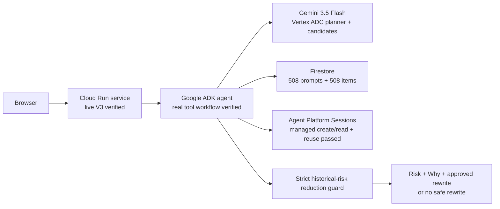

# Preflight

Inspect a video prompt before generating a clip. Preflight retrieves five similar historical prompts, reports a statistical risk signal, and asks a connected Gemini agent for an alternative prompt. The interface presents an alternative only when its historical risk estimate is strictly lower than the original prompt’s estimate. No video is generated.

**Track A is deployed; V3, V5 and V6 are PASS.** Open [the live Preflight app](https://preflight-jcgro45veq-as.a.run.app). The user resolved the former G0 setup gate; local preview remains a fallback. Real Cloud Run requests execute ADK tools, use Gemini through Vertex ADC, and persist/reuse managed sessions. The ten-case live run verified strictly lower historical risk and the genuine tool workflow for all ten cases. Full acceptance is not claimed: V4 remains FAIL, and V7 is partial with zero verdicts. Track B has not started.

## Current evidence

Observed on 2026-10-16:

| Component | Observed result | Limit |
| --- | --- | --- |
| Firestore | Named database `preflight-aibc` in `asia-southeast1`; 508 `prompts_v1` records and 508 `items_v1` records imported; content integrity verified for 1,016/1,016 historical documents with zero differences | `verdicts_v1` has zero records at this snapshot; V7 is partial, not PASS |
| Agent Platform Sessions | Genuine managed-session create/read health check passed | Minimum supported TTL is 24 hours; this does not prove the full rewrite workflow |
| Vertex Gemini | Gemini 3.5 Flash runs through Vertex Application Default Credentials in Singapore; real ADK requests succeeded | Statistical improvement does not establish generated-video quality |
| ADK workflow | Google ADK 2.12.0 executes genuine signed tool calls; the observed workflow uses three planner calls and one candidate-generation call; V5 and V6 passed all ten live cases | Lower historical risk does not establish generated-video quality |
| Cloud Run | V3 PASS: five sample requests returned HTTP 200, each with six tool-trace entries and verified sessions | Cold request 12.598004s; warm requests 4.363051–5.209227s; these are observed timings, not a service guarantee |
| Track B | Not started; G1 opens after any user reply or two hours after the G1 notice, whichever occurs first | No video upload, video verdict, feedback acceptance, or Veo call is claimed |

The separate AI Studio API-key planner attempt returned HTTP 402 because prepaid credit was depleted. Production explicitly selects Vertex ADC. It does not silently fall back between credential backends. No credential value or actual cloud project identifier belongs in this repository.

## Run the local fallback

Use Python 3.12 for parity with the cloud container. The historical local G0 receipts used Python 3.10.11 on macOS ARM64; those receipts do not establish the current cloud environment.

```sh
python3.12 -m venv .venv
.venv/bin/python -m pip install -r requirements.lock
.venv/bin/python -m uvicorn app:app --host 127.0.0.1 --port 8080 --no-access-log
```

Open [the local app](http://127.0.0.1:8080). The default local mode makes no external model calls. Bundled artifacts load at startup; missing artifacts fail startup rather than silently substituting sample results. The interface calls the real local predictor and labels Gemini rewriting unavailable in local mode.

The cloud dependency set is recorded separately in `requirements-cloud.txt` and `requirements-cloud.lock`: Google ADK 2.12.0 and FastAPI 0.133.0 are pinned. `Dockerfile` uses Python 3.12 slim pinned by SHA-256 digest and runs as an unprivileged user. Installing dependencies or building that image does not constitute a cloud deployment.

## Architecture

The deployed cloud path is verified by actual requests:



The backend uses bundled lexical retrieval and reads the corresponding historical rates and item parameters from Firestore in cloud mode. The local fallback uses the bundled aggregates directly. The [architecture screen](static/architecture.html) reads `/api/status` and labels each connection from the actual runtime flags. It shows an active session badge only when managed-session readiness is confirmed.

The interface retains a returned opaque `session_id` in JavaScript memory and sends it on subsequent checks. Reloading clears that memory. The server maintains anonymous ownership using a random HttpOnly `pf_user` cookie; requests do not accept a public `user_id` field. No API credentials are sent by the browser.

## Runtime configuration

Supply configuration through the runtime environment or the deployment’s credential mechanism. The table lists variable names without secret assignments or real project identifiers.

| Variable | Purpose |
| --- | --- |
| `PREFLIGHT_MODE` | Select `cloud` for the connected workflow; `local-g0` keeps the local fallback |
| `PREFLIGHT_GEMINI_BACKEND` | Production explicitly selects `vertex`; there is no automatic backend fallback |
| `GOOGLE_CLOUD_PROJECT` | Runtime-only cloud project selection |
| `GOOGLE_CLOUD_LOCATION` | Managed-session region; current verified component region is `asia-southeast1` |
| `PREFLIGHT_GEMINI_LOCATION` | Optional explicit Vertex model region; otherwise uses the configured cloud location |
| `PREFLIGHT_GEMINI_MODEL` | Gemini model selection; current target is `gemini-3.5-flash` |
| `PREFLIGHT_SESSION_ENGINE_ID` | Runtime-only managed-session application resource |
| `PREFLIGHT_FIRESTORE_DATABASE` | Dedicated named database; current database is `preflight-aibc`; the default database is rejected |
| `PREFLIGHT_TOTAL_REQUEST_LIMIT` | Cumulative admitted-check allowance; default and maximum are 1,000 |
| `GEMINI_API_KEY` | Only for an explicitly selected API-key backend; unused by the production Vertex path |

Application Default Credentials are required for the production Vertex and Firestore path. Keep credentials and resource identifiers out of source, screenshots, command transcripts, and committed logs. The pre-commit guard scans worktree files and staged blobs for forbidden credential markers without printing values.

Verified Cloud Run settings are region `asia-southeast1`, minimum instances zero, platform-default concurrency 80, and timeout 36 seconds. The timeout is the ceiling of twice the slowest calibration request: `ceil(2 × 17.707208)`. The separate V3 run measured a 12.598004-second cold request and 4.363051–5.209227-second warm requests. Scaling settings do not establish latency beyond the measured requests.

## Data source and licence

The unchanged supplied parquet comes from [TIGER-Lab/GenAI-Bench](https://huggingface.co/datasets/TIGER-Lab/GenAI-Bench), video generation **test** split, not the smaller filtered test_v1. Credit: Jiang et al., *GenAI Arena: An Open Evaluation Platform for Generative Models* (2024). The dataset card declares [CC BY 4.0](https://creativecommons.org/licenses/by/4.0/). See [NOTICE.md](NOTICE.md) for attribution and derived-data changes.

The supplied file’s SHA-256 is `c58ba145070415d084950fe8a80c517fd14e05d3285e371338a66791cee5de94`; the build verifies this value. There are 1,911 human pairwise votes, 508 prompts, 10 models and 2,080 observed prompt/model cells. The 407 both-bad votes are 21.30% of votes. They do not establish the share of money wasted or the probability a single clip is usable.

Each left/right win contributes 1/0, loss 0/1, tie 0.5/0.5, and both-bad 0/0. A prompt/model cell is the mean of its observations; an unobserved cell remains missing. `prompts_v1.jsonl` and `items_v1.jsonl` preserve the derived outcomes and fitted item parameters used for the verified Firestore import. There is no fabricated verdict log.

## Methods and limits

The historical risk estimate is the **unweighted mean of five nearest prompt both-bad vote rates**, using word TF-IDF with 1–2 grams and cosine similarity. A query may include the exact historical prompt itself. Zero-similarity neighbours are disclosed. An input with no vocabulary overlap receives null risk, null budget and no IRT estimates. Lexical similarity is evidence coverage, not semantic understanding. If a response supplies additional risk semantics, the interface displays them and separately identifies the historical vote estimate when supplied.

The 2PL fit uses fractional cell outcomes and one likelihood contribution per observed cell. The audited reference objective adds squared ability with coefficient 1, squared difficulty with coefficient 0.1, and squared deviation of discrimination from one with coefficient 1. Positive discrimination is bounded to [0.3, 4]. The fresh solver uses direct bounds and an analytic gradient; the supplied reference used clipping inside an unconstrained solver. Fit settings and optimizer diagnostics are saved with the artifact. Cold-start difficulty and discrimination are the arithmetic mean over the same five text neighbours. Model scores are historical relative cell-response estimates, not calibrated usable-video probabilities.

Gemini proposes candidates; the statistical guard decides whether one may be presented. An `improved` status requires a strict decrease from `p_fail_before` to `p_fail_after`. The interface also checks this inequality before exposing the candidate or its copy control. Otherwise it shows no safe rewrite or an unavailable rewrite. A lower historical score does not establish better generated-video quality.

**Limits:** the evidence comes from 2024-era public votes. Preflight does not route between video models, validate current Veo performance, establish money saved, or inspect videos in Track A. Positive discrimination gives the same model ordering for every item. No novel published research result is claimed.

The supplied preregistration defines Q1–Q4 but no both-bad AUC target or evaluation. The supplied results file has a diagnostic prefix before its JSON and does not contain the claimed exact 0.72 both-bad AUC. The declared V4 both-bad diagnostic is **FAIL**: AUC `0.6683289428340439` is below `0.68`. The exact 0.72 reproduction remains **UNVERIFIABLE**. Preregistered cell tests and declared both-bad diagnostics remain separate; thresholds and seeds are not changed to turn a failure into a pass.

## Cost assumptions

The illustrative scenario uses Veo 3.1 Standard, audio, 720p/1080p, eight seconds at USD 0.40/second, checked on 2026-10-16 against [Google’s Gemini API price page](https://ai.google.dev/gemini-api/docs/pricing#veo-3.1). One attempt is USD 3.20. The budget illustration is `3.20 × min(1 / (1 − p_fail), 5)`; a risk of one uses the cap. Prices can change.

This is a hypothetical budget, not a forecast or a measured saving. Treating the historical both-bad rate as a current Veo failure probability is unvalidated. Gemini rewrite requests, cloud hosting, taxes and discounts are excluded from the displayed video-generation budget. The local fallback incurs no generation fee; the connected workflow can incur Gemini and cloud charges. No Veo generation is called.

## Sample prompts

Paste any of these into the input, or use its sample buttons:

1. a cat and a dog
2. a spoon and a laptop
3. a bicycle and a car
4. indoor gymnasium
5. a purple clock

## Operational limits

Prompts are limited to 4,000 characters. Cloud mode uses a shared Firestore transaction to admit at most 20 checks per rolling minute across instances, with a cumulative allowance of at most 1,000 admitted checks. Admission can count a request even if a later external step fails. The local fallback retains a process-local 20-per-minute limiter. These are service-wide budgets, not per-user allowances.

Invalid input receives HTTP 422, exhausted budgets HTTP 429, and an unavailable connected service HTTP 503. There is no login and no public video-generation endpoint. A shared budget is not an authentication system.

## Verification and continuation

See [COMPLETION_REPORT.md](COMPLETION_REPORT.md) for the acceptance ledger, commands, receipts, failures and pending checks. [`reports/`](reports/) contains machine-readable receipts and [`logs/`](logs/) contains redacted command output. Earlier local browser and latency receipts prove their recorded local scope only; they must not be relabeled as cloud evidence. Freshness checks compare against the external attachment and do not prove authorship or creation date.

V3 is PASS. The [actual cloud browser receipt](reports/browser_cloud_qa.json) records two additional live requests: spoon/laptop produced an approved reduction from 53.5% to 36.7%; purple clock retained 5.7% and correctly exposed no alternative or copy control. The second request reused the same opaque managed session. Desktop and mobile views had no overflow or observed browser errors. The copy handler was checked using an instrumented clipboard write; the user’s clipboard was neither read nor overwritten.

The [live rewrite receipt](reports/rewrites_live.json) records V5 PASS and V6 verification for all ten selected cases: ten HTTP attempts, zero retries, ten strict historical-risk reductions, ten verified tool workflows, and no higher-risk result returned. The [Firestore integrity receipt](reports/firestore_integrity.json) independently matches all 1,016 expected historical documents to the exported content with zero differences.

V4 remains FAIL and the exact 0.72 claim remains UNVERIFIABLE. V7 is partial with zero verdict records; Track B has not started. G1 opens after any user reply or two hours after the G1 notice, whichever occurs first. Component readiness, browser checks, deployment, and each acceptance gate remain separate claims.
