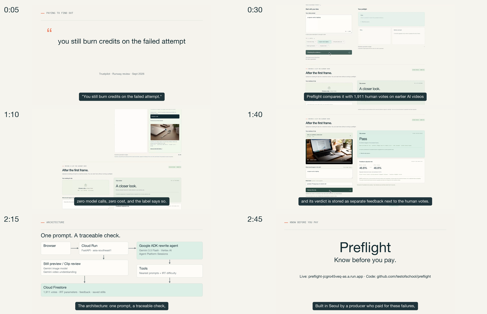

# Preflight final package v5

Report date: 2026-10-18, Asia/Seoul. Track D is waiting for Felix's public YouTube URL and does not block A, B, or C. Felix will inspect the local video before uploading.

| Track | State | Result |
| --- | --- | --- |
| A — admission cap | DONE / PASS | `preflight-00027-pit`, 100% traffic; 500/day, 5/min; 94 passing tests; unchanged image and runtime |
| B — prescribed-template pitch PDF | BLOCKED | `docs/template/aibc_template.pptx` is absent; no substitute deck or PDF created |
| C — captioned final video | DONE / VERIFIED LOCAL EXPORT | 2:52.000; 1920×1080; 30 fps; H.264; silent; 8,109,690 bytes; six check frames verified |
| D — public video link | WAITING FOR INPUT | No public URL supplied; both `<VIDEO_URL>` placeholders remain |

## A — admission cap

Production revision is **`preflight-00027-pit` at 100% traffic**, promoted at 17:23 KST after the candidate passed every HTTP gate. The only effective revision-spec change was `PREFLIGHT_PREVIEW_DAILY_LIMIT=60` → `500`. The per-minute limit remains **5**. Both live image generation and warming remain **false**.

Unchanged native image digest:

```text
sha256:4bf0668ae549f7ab924f17e36105b621f1f25676aefb6e53e06154db4384e932
```

The offline gate passed **94 tests, 0 failures**, comprising **57 new v5 cases and 37 existing cases**. It covers every original sample and pinned rewrite, both request variants, saved hits, missing cache documents, normalized whitespace, typed rejection, malformed metadata, admission/cache errors, the 500/day boundary, and 5/min. Missing documents return the limited message with **0 model calls**. These are offline tests using fakes and model-call tripwires.

| Candidate check | Observed result |
| --- | --- |
| `/api/status` | HTTP 200; `preview_mode="samples"` |
| Two saved sample `/preview` requests | 2/2 HTTP 200 cache hits; 0 model calls; $0.00 |
| One typed `/preview` request | HTTP 503; exact limited copy |
| Two sample `/preflight` requests | 2/2 HTTP 200; pinned sample decisions; 0 rewrite calls |
| Native candidate comparison | Only the daily-limit value changed; image digest identical |
| Parent read of production | 100% on revision 27; daily 500; live/warm false; samples mode |

Exactly **1 candidate-creation command**, **1 promotion command**, and **0 rollback commands** were executed. Production remained on revision 25 at 100% throughout candidate gating. An initial local harness precheck failed before cloud mutation because service-template and immutable-revision APIs serialize image/name differently; its evidence is retained. An initial test draft also misclassified whitespace-normalized samples and was corrected. No actual candidate HTTP gate failed. The native revision list skips 26; no failed candidate is inferred from that numbering.

Evidence: [Track A report](track_a_REPORT.md), [tests](track_a_tests.txt), [JUnit](track_a_tests.junit.xml), [candidate](track_a_candidate.json), [HTTP gate](track_a_gate.json), [promotion](track_a_promotion.json), [independent parent verification](track_a_parent_verification.json).

## B — organizer-template pitch PDF

**BLOCKED: required input missing.** The prescribed path `docs/template/aibc_template.pptx` does not exist, and the repository contains no PPTX file. In accordance with the request, Track B stopped. The architecture and limits cards used by Track C do not constitute the required deck.

| Required result | State |
| --- | --- |
| `docs/Preflight_pitch_deck.pdf` | NOT CREATED |
| PDF page count | N/A — no PDF |
| PDF byte size / ≤5,000,000 check | NOT RUN — no PDF |
| Template masters, fonts, slide 1 layout | NOT RUN — template absent |
| Every-page 50 dpi render into `docs/deck_check/` | NOT RUN |
| PDF text extraction / number check | NOT RUN |
| README pending-note replacement / PDF commit | NOT DONE |

Evidence: [B/D readiness](track_bd_readiness.json). README retains its pending-deck note.

## C — final video

**DONE: verified local export, ready for Felix's viewing review.** Human acceptance and YouTube publication remain pending.

Final MP4: [preflight_demo_final.mp4](</Users/felix/Desktop/AI Builder Cup 2026/preflight/demo/preflight_demo_final.mp4>).

```text
/Users/felix/Desktop/AI Builder Cup 2026/preflight/demo/preflight_demo_final.mp4
```

| Fact | Verified value |
| --- | --- |
| Duration | **172.000 seconds / 2:52.000**; within 2:45–2:58 and below 3:00 |
| Resolution | **1920×1080** |
| Frame rate / frame count | **30/1 fps / 5,160 frames** |
| Video | **H.264, yuv420p, MP4 with faststart** |
| Audio stream | **No** — no optional voiceover was supplied; explicit silent fallback used |
| AAC / loudness | **N/A** — no audio stream; −16 LUFS is not claimed |
| File size | **8,109,690 bytes** |
| Captions | Exact supplied C.2 text; **33 timeline cues**, **32 nonempty**, **43 px**, maximum **1 line** |
| Actual overlay check | **32/32 nonempty cue midpoints passed**, plus the intentional transparent 0:10–0:13 interval |
| Full decode | **PASS**, 0 decode errors |
| Independent export audit | **20/20 checks PASS**, bound to the final SHA-256 below |
| Required check frames | **6/6**, actual decoded PNGs at exact requested times |

Final SHA-256:

```text
4bbe0168a40156c06718c53df736ecd90e2314b0539629bed0cc3fa947bdda03
```

The entire **108.366667-second** raw recording remains in sequence at **0:22–2:10**, sped by **1.0033950648×**, with no source cuts. The risk result, rewrite, saved still and clip review remain present. The raw source hash is unchanged. Saved stills and reused review remain labelled in the original recording; no live-generation claim was added.

The intro uses the exact opening C.2 sentences for 0:00–0:04, four required quote cards for 3 seconds each at 0:04–0:16, and the title at 0:16–0:22. The third on-screen quote is not spoken in C.2, so 0:10–0:13 intentionally has no separate caption. The supplied script actually contains 290 words despite its approximate 380-word label; every supplied word is preserved.

The brief specifies a 42-second outro window, but its nominal 10+12+8-second holds total 30 seconds. The export fills the stated 2:10–2:52 window using architecture **12 seconds**, limits **16 seconds**, closing **14 seconds**. This is the documented timing interpretation. No voiceover, synthetic voice, external generation or upload was used.

Visual QA caught missing captions at the intro/raw transition in an earlier render. An isolated A/B render traced this to ffmpeg filter reinitialization when source metadata changed. The renderer now preserves the filter graph with identical frame dimensions/pixel format; all 32 nonempty cue midpoints were checked against the actual export. Earlier failure evidence is retained separately; its MP4 hash is not the final hash above.

| Requested time | PNG | Bytes |
| --- | --- | --- |
| 0:05 | [00m05s.png](../../demo/final_check/00m05s.png) | 145,583 |
| 0:30 | [00m30s.png](../../demo/final_check/00m30s.png) | 353,762 |
| 1:10 | [01m10s.png](../../demo/final_check/01m10s.png) | 420,275 |
| 1:40 | [01m40s.png](../../demo/final_check/01m40s.png) | 575,216 |
| 2:15 | [02m15s.png](../../demo/final_check/02m15s.png) | 279,263 |
| 2:45 | [02m45s.png](../../demo/final_check/02m45s.png) | 190,601 |



Evidence: [native media facts and frame hashes](track_c_video_facts.json), [ffprobe](track_c_ffprobe.json), [full decode](track_c_full_decode.json), [actual overlay checks](track_c_overlay_check.json), [QA](track_c_QA.md), [independent audit](track_c_independent_qa.json), [parent visual review](track_c_parent_visual_review.json), [reproducible renderer](track_c_render.py), [exact caption text](track_c_caption_script.txt), [production contract](track_c_production_contract.md).

## D — deferred public-link update

Felix explicitly confirmed that there is no public URL yet and that this track must not block other tracks. YouTube upload, public/private/unlisted verification, and link replacement are NOT DONE. There is exactly one `<VIDEO_URL>` placeholder in each of `README.md` and `docs/submission-notes.md`.

The submission Brief description is **952 characters**, within **1,024**. Its existing wording is unchanged. Felix's supplied upload title and description are preserved verbatim in [youtube-upload-copy.txt](youtube-upload-copy.txt).

## Source and publication boundaries

Starting main: `de0d563530405adf3dae5a26f5ded3f7a009917d`.

Runtime source tag: `aibc-2026-submission-v3` = `d638c0690cb17d60316922eb30a14f150fe7c23c`. All three existing source tags remain unchanged. All **25 runtime files** match the baseline and source tag. Runtime-source SHA-256: `a3f7c0a10ebec2e00ff7bc7bfc01676c712405aff0a8dad55f8c82eef2364fa7`.

The original raw MP4 remains unchanged: SHA-256 `d1f3772d1187ee7ce1aeed1e0efe3f432c09337e90cc0b7113b6ca37aa94ab78`, **9,300,697 bytes**, **108.366667 seconds**. Initial repository dataless count: **0**.

No runtime code or image was changed. No live/warm image generation or Veo call was made. The local final MP4 and generated intermediates remain outside Git; check frames, the reproducible renderer, tests, and sanitized receipts are the reviewable package. Repository publication checks and commit receipts are recorded below after the package content commit; their exact commit coverage is explicit.

## Anything not done

- **Track B:** prescribed-template deck, PDF export, PDF number/size/page checks, every-page render, README deck-link replacement and PDF commit are not done because the template is missing.
- **Track C:** narration/audio is not produced because no recording was supplied; the requested silent fallback is complete. Felix's full-video acceptance is pending.
- **Track D:** no YouTube upload, URL replacement, or public/private/unlisted visibility check has been performed. This does not block A or C.
- Clip-review accuracy and actual billed spend are not newly measured by this package.
